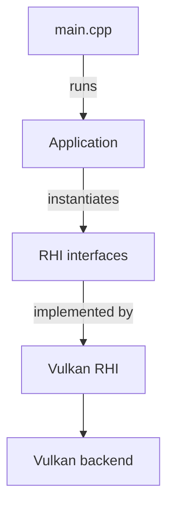

# Vulkan Renderer: built on a custom RHI

## Architecture

## Features

- Render Hardware Interface (RHI) abstraction layer
- Vulkan backend
- Model and texture loading
- MSAA

## Build

**Requirements**

- Windows
- CMake 3.16 or later
- Vulkan SDK 1.3.296.0

> **Note:** assets are loaded from relative paths, so the executable must be launched from its own output directory.

## Credits

- [Vulkan Tutorial](https://vulkan-tutorial.com/)